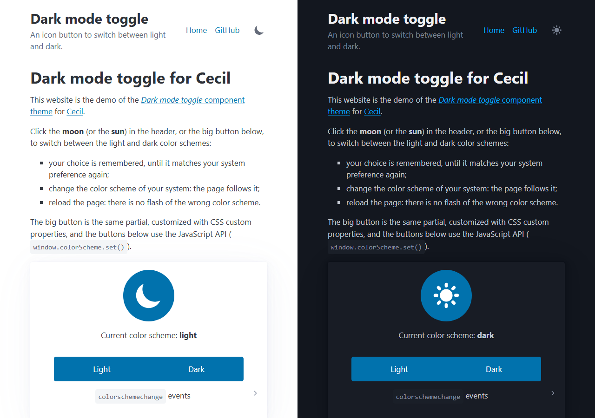

# Dark mode toggle component theme

The _Dark mode toggle_ component theme for [Cecil](https://cecil.app) adds an icon button to switch a website between light and dark color schemes.



**[Demo](https://cecilapp.github.io/theme-darkmodetoggle/)**

## Features

- **Icon button**: a moon in light mode, a sun in dark mode
- Follows the **system preference** by default, and keeps up with its changes
- Remembers the **user choice** (only when it differs from the system preference)
- **No flash** of the wrong scheme on page load
- Framework agnostic: sets a `dark` class, a `data-theme` attribute and the `color-scheme` property on `<html>` (works with Tailwind CSS, Bootstrap, Pico CSS or plain CSS)
- **JavaScript API** and `colorschemechange` event
- Accessible: `aria-pressed` state, translatable label (English and French included)
- **No dependencies**, vanilla JavaScript
- Minimal **customizable style**, through CSS custom properties

## Installation

```bash
composer require cecil/theme-darkmodetoggle
```

> Or [download the latest archive](https://github.com/Cecilapp/theme-darkmodetoggle/releases/latest/) and uncompress its contents in `themes/darkmodetoggle`.

## Usage

Add `darkmodetoggle` in the `theme` section of the `config.yml`:

```yaml
theme:
  - darkmodetoggle
```

Add the following line in the HTML `<head>` of the main template (as early as possible, to avoid a flash):

```twig
{{ include('partials/darkmodetoggle-head.html.twig', {site}, with_context = false) }}
```

Then add the button where you want it to be displayed (in the header for example):

```twig
{{ include('partials/darkmodetoggle.html.twig') }}
```

The button can be included several times, and accepts optional variables:

```twig
{{ include('partials/darkmodetoggle.html.twig', {class: 'ml-2', label: 'Night mode'}) }}
```

### Styling the website

In dark mode, the `<html>` element looks like this:

```html
<html class="dark" data-theme="dark" style="color-scheme: dark;">
```

And in light mode:

```html
<html data-theme="light" style="color-scheme: light;">
```

So the dark styles of the website can be written with:

- Tailwind CSS: the `dark:` variant, with `@custom-variant dark (&:where(.dark, .dark *));` (v4) or `darkMode: 'class'` (v3)
- Bootstrap: set the `class` option to an empty string and target `[data-theme="dark"]`, or rely on the `colorschemechange` event to set `data-bs-theme`
- Plain CSS: `:root[data-theme="dark"] { … }`

### Configuration

Default options:

```yaml
darkmodetoggle:
  storage_key: theme # localStorage key of the user preference
  class: dark        # class added to <html> in dark mode (empty to disable)
  style: true        # minimal button style (false to style it yourself)
```

The button style can be customized with the following CSS custom properties:

```css
.darkmodetoggle {
  --darkmodetoggle-size: 1.5rem;          /* icon size */
  --darkmodetoggle-padding: .25rem;
  --darkmodetoggle-radius: .375rem;
  --darkmodetoggle-color: currentColor;
  --darkmodetoggle-background: transparent;
}
```

Available CSS classes: `.darkmodetoggle` (button), `.darkmodetoggle-icon-dark` (moon icon) and `.darkmodetoggle-icon-light` (sun icon).

### JavaScript API

```js
window.colorScheme.current(); // 'light' or 'dark'
window.colorScheme.set('dark');
window.colorScheme.toggle();

document.addEventListener('colorschemechange', (event) => {
  console.log(event.detail.scheme); // 'light' or 'dark'
});
```

Any element with the `data-darkmodetoggle` attribute toggles the color scheme when clicked.

### Internationalization

The button label and title are translatable (English and French included):

```yaml
# translations/messages.<locale>.yml
"Dark mode": "Mode sombre"
"Toggle dark mode": "Basculer le mode sombre"
```

## Demo

The [`demo`](demo/) directory contains a website using the theme (with [Pico CSS](https://picocss.com)). To run it locally:

```bash
php demo/link.php
php cecil.phar serve demo
```

> `demo/link.php` links the repository as `demo/themes/darkmodetoggle`, so the demo uses the theme under development.

## License

_Dark mode toggle_ is a free software distributed under the terms of the MIT license.
